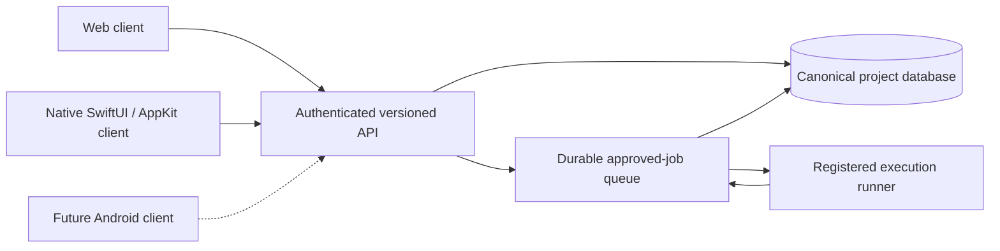

# Web, native Mac and release workflow

Date: 16 October 2026. Status: architecture and CI preparation; hosted API, native client and automatic deployments are not yet implemented.

## Shared data

Both clients use the same owner identity, project IDs, server revisions and approval state. Authenticated polling or server events refresh views; the API remains authoritative. Mutations use revision checks plus idempotency keys for retries. Native caches are read-only snapshots initially; unsent drafts are local until submitted. Offline state is explicit. Logging in on a second client does not duplicate agent work.

Runtime records, OAuth tokens, chat histories and generated artifacts are not committed to GitHub. API/business-rule changes and user-data synchronization are separate concerns. A public code repository can serve a private application without making its user data public.

## Native macOS experience

The owner now requests a genuinely native Mac interface. Use SwiftUI/AppKit for window structure, navigation, chat, project lists, settings, keyboard shortcuts and sheets. Use Keychain for credentials and normal macOS download/open behavior. Web content may remain for explicitly chosen complex visualizations during migration, but a renamed browser wrapper must not be described as a fully native client.

Opening CADF connects to the hosted API and restores the owner session. If a local agent runner remains necessary, the application manages its lifecycle and reports whether it is connected; no Terminal command is needed. The UI must distinguish server availability from runner availability. The cloud host being awake does not imply this Mac is awake.

Native releases need a build/package pipeline, update verification and two-version compatibility tests. Sparkle is a candidate for signed HTTPS updates. Signing keys remain outside the repository. Apple code signing/notarization and distribution credentials must be evaluated separately under the owner's budget; no membership purchase is authorized. Do not implement an unsigned self-updater that downloads and executes arbitrary repository code.

## Branches created

`develop` and `testing` were created locally and on GitHub from existing `main` commit `d4eccdfcf6608a43d1bca1ab015a4ed267456631`. `main` remains unchanged. The owner authorized publishing the current implementation on `cadf/command-centre` and a draft PR into `develop`; the baseline branches do not contain it until reviewed integration. No private operational files were uploaded. Ignore rules now also cover nested store lock files and temporary transaction files.

| Branch | Purpose | Promotion |
| --- | --- | --- |
| `feature/<name>` or `fix/<name>` | Isolated agent work, one accountable owner | PR to `develop` |
| `develop` | Integrated development baseline | Reviewed PR to `testing` |
| `testing` | Release-candidate acceptance and staging | Owner-approved PR to `main` |
| `main` | Approved production source | Versioned release and deployment |
| `hotfix/<name>` | Urgent bounded fix from production | Review into `main`, then forward-merge to `develop` and `testing` |

Create feature/hotfix branches when work is assigned; do not create empty permanent agent branches. Use separate worktrees. Do not reset or overwrite another agent's changes. Test data is synthetic and separate from production data.

## What updates automatically

Target flow:

`feature PR → checks/review → develop → testing + staging → owner approval → main + release tag → deploy API/web + publish signed Mac update`

Pushing experimental code to a feature branch must not change the production website or installed Mac app. After an approved production release, the website serves the new version; the Mac client obtains its verified native update according to its update preferences. A Mac installation may remain on the older version until it can restart, so the server must support the previous client API during the rollout.

Use one release manifest binding the Git commit, API version, database migration version, website build and Mac build. Promote tested artifacts rather than rebuilding different source for production. Backward-compatible migrations deploy before new clients. Breaking migrations require a recovery plan; reverting application code is not automatically a safe database rollback.

## Prepared now versus pending

- **Created:** remote/local `develop` and `testing`; existing `main` preserved.
- **Included in the implementation branch:** `.github/workflows/checks.yml` runs structure, private-path, unit/HTTP and JavaScript checks. It has read-only permissions, a pinned checkout action, one standard Linux runner, no model credentials and no deployment job. `.github/pull_request_template.md` captures review and release impact.
- **CI evidence:** the local test suite passed 78 tests. The workflow will run on implementation-branch pushes and PRs; use the GitHub check result for remote evidence. A local pass is not a remote CI result.
- **Not configured yet:** branch protection, required check contexts, staging/production environments, cloud roles, deployments, signed app updates and release tags.

After the workflow's first successful GitHub run, require its `CADF checks` context on `develop`, `testing` and `main`; block force pushes/deletion and require PRs. Record a real independent review and owner approval. Because current agents share the owner's Git identity, requiring a second GitHub approving user without an actual collaborator would deadlock the workflow and would not establish independent review. Do not invent a reviewer or use the author's approval as peer review.

Production deployment credentials belong only to an approved GitHub environment with a protected release source. Prefer short-lived cloud identity federation over stored access keys. Untrusted PR checks have no secrets and never run on the owner's Mac. Standard public-repository runners are the initial zero-budget CI choice; do not enable larger paid runners or migrate to a private-repository billing model silently.

## Release acceptance

- Unauthenticated and wrong-user requests cannot read projects, chats, downloads or events.
- Web and native Mac show the same record after a mutation, including concurrent-write conflicts.
- A restarted runner cannot execute a job twice; private room context stays isolated.
- A failed update leaves a working previous app and a recoverable server deployment.
- The previous Mac version remains compatible throughout rollout.
- Opening the app requires no manual server commands.
- Credits/expiry and unsupported/offline agent routes remain visible; no paid fallback.

## References

- [GitHub Actions billing](https://docs.github.com/en/billing/concepts/product-billing/github-actions)
- [Protected branches](https://docs.github.com/en/repositories/configuring-branches-and-merges-in-your-repository/managing-protected-branches)
- [GitHub deployment environments](https://docs.github.com/en/actions/how-tos/deploy/configure-and-manage-deployments/manage-environments)
- [Sparkle setup and signed update guidance](https://sparkle-project.org/documentation/)
